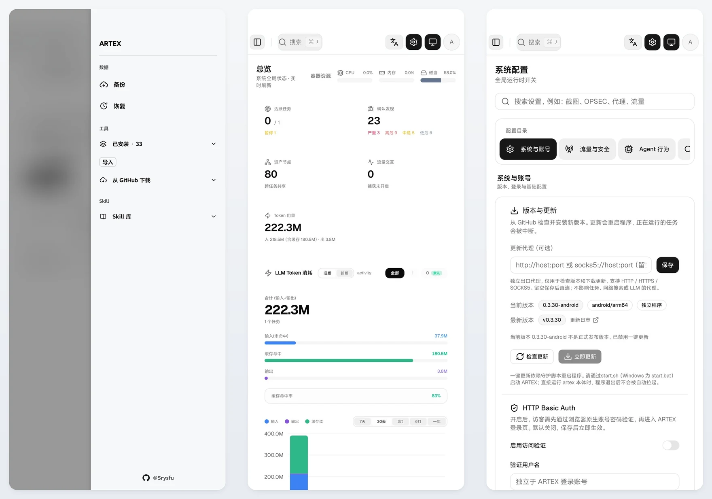

<div align="center">

# ARTEX Android

**把 ARTEX 装进手机。后端、数据库、Python 全在 APK 里，不连任何外部服务器。**

[](https://github.com/Srysfu/artex-android/releases/latest)
[](#装)
[](#装)
[](#)

<picture>
  <source media="(prefers-color-scheme: dark)" srcset="docs/images/banner-dark.webp">
  
</picture>

</div>

## 它是什么

ARTEX 是一个 AI 自主渗透测试系统。原版跑在服务器上，要装 Docker、配数据库、开端口。

这个项目把整摞东西塞进了一个 APK：

```
┌─────────────────────────────────────────┐
│  ARTEX 后端（Go 静态二进制，PIE）        │
│  PostgreSQL 18.6                         │
│  Python 3.14  +  impacket / pypykatz     │
│  bash  +  readline / ncurses / iconv     │
└─────────────────────────────────────────┘
              ↓ 全部跑在手机里
        WebView 打开 127.0.0.1:8787
```

没有服务器，没有容器，没有网络依赖。飞机上也能用。

## 装

去 [**Releases**](https://github.com/Srysfu/artex-android/releases/latest) 下 `ARTEX-x.y.z.apk`，装。

| | |
|---|---|
| **系统** | Android 8.0+ |
| **首次启动** | 1-2 分钟（初始化 PostgreSQL） |
| **体积** | APK 60 MB，首次启动后约 250 MB |
| **工具** | 不放 APK 里，面板里按需下 |

## 用

| 手势 | 作用 |
|---|---|
| **双指左滑** | 打开右侧面板 —— 备份恢复 · 工具管理 · Skill 管理 |
| **双指右滑** | 打开网页侧栏 —— 任务、资产、发现、报告 |
| **返回键** | 先网页后退，退到底再按才退出 APP |
| **电脑访问** | 同一 WiFi 下开 `http://手机IP:8787` |

完整说明见 **[docs/USAGE.md](docs/USAGE.md)**。

## 工具

32 个工具放在独立仓库，APK 里一个都没有 —— 需要哪个下哪个，带 sha256 校验。

```
资产测绘  subfinder  shuffledns  puredns  alterx  asnmap  cloudlist
          cdncheck  uncover  gau
探测指纹  httpx  dnsx  tlsx  naabu
内容发现  katana  ffuf  gobuster
漏洞扫描  nuclei  afrog  dalfox  gitleaks  interactsh-client
隧道穿透  gost  npc  chisel  suo5  frp  ligolo
工具箱    fscan  gogo
其他      notify
```

这样 APK 从 154 MB 降到 60 MB，工具也能独立更新。

## 改

| 想做什么 | 看哪里 |
|---|---|
| 自己构建一个 APK | [docs/BUILD.md](docs/BUILD.md) |
| 壳对后端做了哪些适配 | [docs/ADAPTATION.md](docs/ADAPTATION.md) |

> 壳里做了不少不显然的事：Android 没有 `resolv.conf`，所以 DNS 要自己注入；
> PostgreSQL 二进制硬编码了 Termux 路径，靠 31 字符等长替换绕过去；
> Android 10 起禁止执行私有目录二进制，所以 targetSdk 必须停在 27。
> 这些都在 [ADAPTATION.md](docs/ADAPTATION.md) 里。

## 上游

[RuoJi6/ARTEX](https://github.com/RuoJi6/ARTEX) · 本仓库对应提交 `a05a886`

<div align="center"><sub>ARTEX 后端与前端版权归上游作者所有</sub></div>
